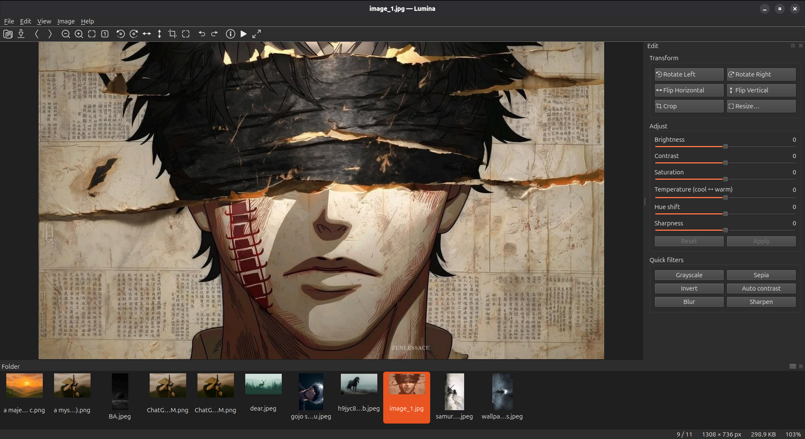
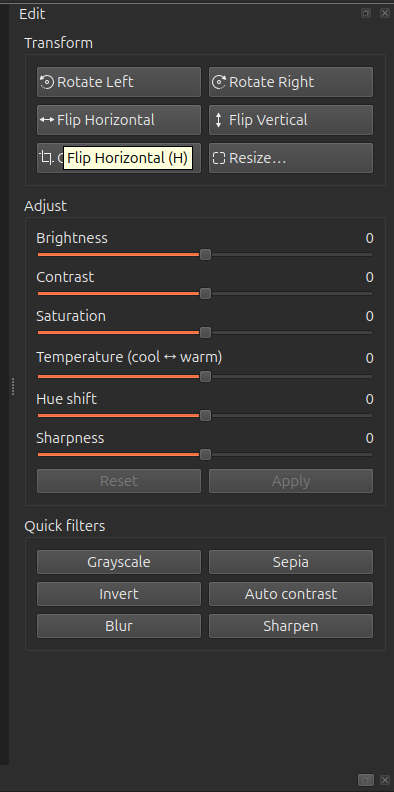
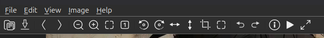
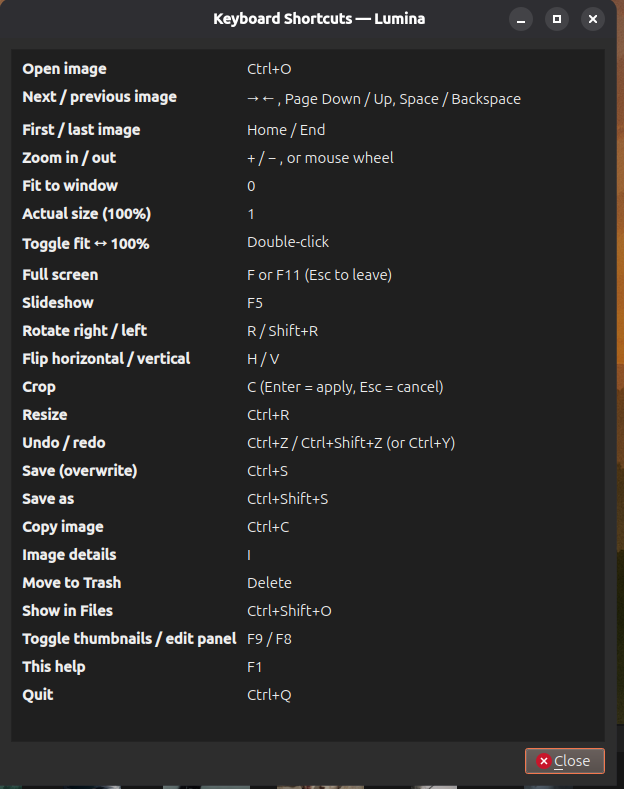

# Lumina

Lumina is a fast image viewer and editor for Linux, built with Python, PySide6, and Pillow.

It provides folder browsing, thumbnails, image editing, EXIF metadata inspection, slideshow mode, and desktop background support.

## Features

- Browse images in a folder with a thumbnail strip
- Open images by double-clicking them or passing a file path
- Zoom, fit to window, and view at 100%
- Rotate and flip images
- Crop and resize images
- Adjust brightness, contrast, saturation, temperature, hue, and sharpness
- Grayscale, sepia, sharpen, blur, invert, and auto-contrast filters
- Undo and redo editing operations
- Save over the original image or use Save As
- View complete image metadata and EXIF information
- Copy image data to the clipboard
- Set an image as the desktop background
- Full-screen mode and slideshow
- Drag and drop image files into the application

## Supported image formats

- JPEG: `.jpg`, `.jpeg`
- PNG: `.png`
- WebP: `.webp`
- GIF: `.gif`
- BMP: `.bmp`
- TIFF: `.tif`, `.tiff`

## Requirements

- Ubuntu or another Linux distribution
- Python 3
- PySide6
- Pillow

The installer also installs the Qt system libraries required by Lumina.

## Installation

### Install from source

Clone the repository and run the installer:

```bash
git clone https://github.com/Fazalkhan987/pyqt-image-viewer.git
cd pyqt-image-viewer
chmod +x install.sh
./install.sh
```

After installation, find **Lumina** in your application launcher or run:

```bash
lumina
```

Open an image directly:

```bash
lumina photo.jpg
```

If the `lumina` command is not found, log out and back in so that `~/.local/bin` is added to your `PATH`.

### Install from a Debian package

Build the package:

```bash
chmod +x build-deb.sh
./build-deb.sh
```

Install the generated package:

```bash
sudo apt install ./lumina.deb
```

Remove the installed package:

```bash
sudo apt remove lumina
```

## Usage

Open Lumina from the application launcher, or use the command line:

```bash
lumina [IMAGE_OR_FOLDER]
```

Examples:

```bash
lumina photo.jpg
lumina ~/Pictures
```

To open the image details dialog, press `I` or `Ctrl+I`.

## Image metadata

The Image Details dialog displays:

- File information and size
- Dimensions, megapixels, aspect ratio, and color mode
- Frame and animation information
- DPI and embedded color profile status
- Camera make, model, lens, ISO, aperture, exposure, flash, and focal length
- GPS coordinates and altitude when available
- All available EXIF tags
- Embedded PNG, JPEG, WebP, and TIFF metadata

Select **Copy to Clipboard** in the details dialog to copy the metadata.

## Set an image as desktop background

Use one of these options:

- **File → Set as Desktop Background**
- **Image → Set as Desktop Background**
- Right-click the image and select **Set as Desktop Background**

GNOME/Ubuntu uses `gsettings`. KDE Plasma uses `plasma-apply-wallpaperimage`.








## Development

Create a virtual environment and install the Python dependencies:

```bash
python3 -m venv .venv
source .venv/bin/activate
pip install -r requirements.txt
```

Run Lumina from the source tree:

```bash
python3 lumina.py
```

Run it with an image:

```bash
python3 lumina.py photo.jpg
```

## Uninstall the source installation

If Lumina was installed with `install.sh`, run:

```bash
./install.sh --uninstall
```

## License

Add your preferred license before publishing the project. A common choice for open-source projects is the MIT License.
